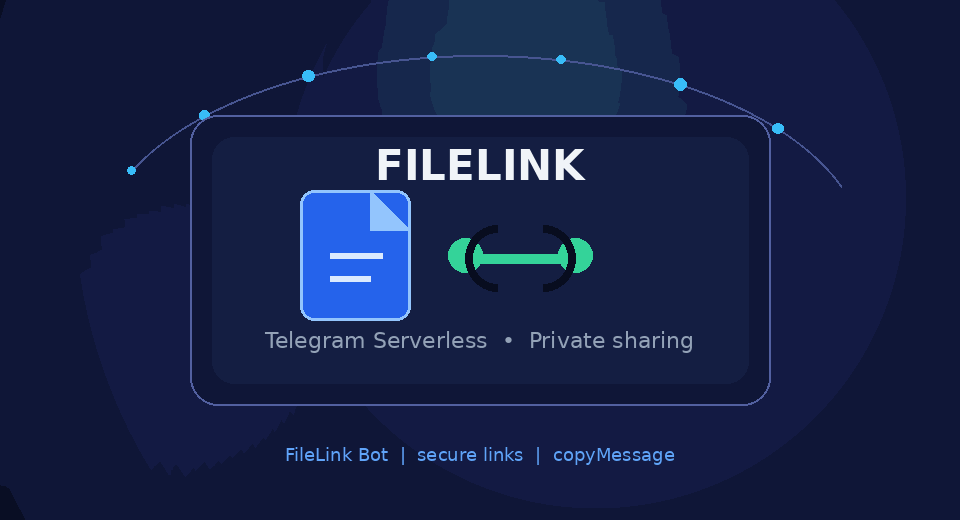
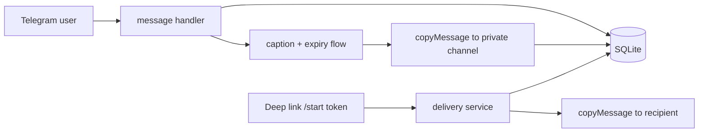

<div align="center">

# FileLink Bot

### Secure Telegram file sharing, powered by Telegram Serverless



<p>
  <a href="https://core.telegram.org/bots/serverless"></a>
  
  
  
</p>

<p dir="rtl"><strong>فایل را بفرستید، لینک امن بسازید، و بدون سرور اختصاصی به اشتراک بگذارید.</strong></p>

</div>

<div dir="rtl">

## معرفی

**FileLink Bot** یک ربات فارسی اشتراک‌گذاری فایل برای Telegram Serverless است.
کاربر فایل را ارسال می‌کند، کپشن و مدت اعتبار را انتخاب می‌کند و یک لینک اختصاصی
دریافت می‌کند. فایل در یک کانال خصوصی تلگرام آرشیو می‌شود و هنگام بازشدن لینک، با
`copyMessage` به دریافت‌کننده ارسال می‌شود.

باینری فایل در Runtime دانلود نمی‌شود و پروژه به VPS، Express، Redis، Worker یا
Long Polling نیاز ندارد.

## قابلیت‌ها

| قابلیت | توضیح |
| --- | --- |
| رسانه‌ها | Document، Photo، Video، Audio، Animation و Voice |
| کپشن | فارسی، انگلیسی، ایموجی و چندخطی تا ۱۰۲۴ کاراکتر |
| انقضا | از ۱ تا ۳۶۵۰ روز یا بدون تاریخ انقضا |
| لینک | توکن تصادفی امن با ۱۲۸ بیت آنتروپی |
| آرشیو | کانال خصوصی و `copyMessage` بدون دانلود فایل |
| مدیریت | نمایش فایل‌های من و غیرفعال‌سازی لینک توسط صاحب فایل |
| امنیت | کنترل مالکیت، Session Version، Idempotency و Rate Limit |
| رابط کاربری | پیام‌ها و دکمه‌های فارسی برای مسیر اصلی کاربر |

## شروع سریع

### ۱. تنظیم پروژه

```bash
npm install
npm test
npm run check
npm run lint
```

### ۲. تنظیم کانفیگ

در `tgcloud/lib/config.js` مقدارهای واقعی را وارد کنید:

```js
export const OWNER_TELEGRAM_ID = 123456789;
export const STORAGE_CHANNEL_ID = -1001234567890;
export const BOT_USERNAME = 'YourBotUsername';
```

ربات باید در کانال خصوصی Administrator و دارای مجوز ارسال پیام باشد. شناسه کانال
برای کانال خصوصی معمولاً با `-100` شروع می‌شود.

### ۳. Deploy و Migration

```bash
npx tgcloud login
npx tgcloud status
npx tgcloud diff
npx tgcloud push
npx tgcloud migrate --dry-run
npx tgcloud migrate
```

### ۴. تست دستی

1. به ربات `/start` بفرستید.
2. یک فایل کوچک ارسال کنید.
3. کپشن و مدت اعتبار را انتخاب کنید.
4. لینک ساخته‌شده را با یک حساب دیگر باز کنید.

## حریم خصوصی

- فایل‌ها در کانال خصوصی آرشیو می‌شوند.
- مدیران کانال امکان مشاهده فایل‌های آرشیوی را دارند.
- هر دارنده لینک می‌تواند فایل را دریافت کند.
- غیرفعال‌سازی لینک به معنی حذف فیزیکی فایل از تلگرام نیست.
- پروژه وعده رمزنگاری سرتاسری یا حذف قطعی فایل از زیرساخت تلگرام نمی‌دهد.

</div>

## English

### What is FileLink Bot?

FileLink Bot is a production-oriented Telegram file-sharing bot built for
Telegram Serverless. A user sends a supported media message, chooses an optional
caption and expiration, and receives a private share link. The bot archives the
message in a private Telegram channel and delivers it with `copyMessage` when the
link is opened.

The runtime is stateless and serverless: no VPS, HTTP server, polling loop,
Redis, queue worker, or binary download is required.

### Highlights

- **Media:** document, photo, video, audio, animation, and voice.
- **Captions:** plain text up to Telegram's 1024-character caption limit.
- **Expiration:** 1–3650 days or no expiration, evaluated lazily on delivery.
- **Secure links:** 16 bytes from Web Crypto, encoded as Telegram-compatible tokens.
- **Archive:** private-channel storage using `copyMessage` with an explicit caption.
- **Delivery:** status, expiration, disabled-link, and duplicate-delivery checks.
- **Resilience:** versioned sessions, claim-owned update leases, retry recovery,
  pending delivery reservations, and conditional database updates.
- **Runtime:** native Telegram Serverless modules under `tgcloud/`.

### Architecture



### Project layout

```text
tgcloud/
├── handlers/
│   ├── message.js
│   └── callback_query.js
├── lib/
│   ├── archive.js
│   ├── delivery.js
│   ├── file-parser.js
│   ├── idempotency.js
│   ├── sessions.js
│   ├── tokens.js
│   └── ...
└── schema.js
```

### Database tables

| Table | Responsibility |
| --- | --- |
| `users` | Telegram identity and display metadata |
| `files` | Source media, metadata, token, archive state and expiry |
| `sessions` | One versioned workflow per user |
| `processed_updates` | `PROCESSING`, `FAILED`, and `COMPLETED` update claims |
| `deliveries` | `PENDING`/`SENT` delivery reservations and timestamps |
| `rate_limits` | Per-user request window |

### Commands

```bash
npm test              # unit tests
npm run check         # JavaScript syntax check
npm run lint          # runtime compatibility checks
npm run deploy        # tgcloud push
npm run status        # tgcloud status
npm run diff          # tgcloud diff
npm run migrate       # tgcloud migrate
```

### Compatibility and limitations

The project targets `@tgcloud/cli` 0.2.x and uses relative `.js` imports inside
`tgcloud/`. The SDK also exposes `InputFile`, `getFileContent`, and
`getFileStream`; FileLink intentionally keeps the product path on `copyMessage`.

Albums/media groups, stickers, and video notes are rejected. Expiration is lazy.
An unknown external Bot API result cannot provide an absolute Exactly-Once
guarantee; archive and delivery reservations record that uncertainty instead of
blindly retrying.

Local checks currently cover media parsing, metadata extraction, captions,
expiration boundaries, and secure token format. Live Bot API, hosted SQLite,
channel permissions, migration, and production webhook behavior require a
dedicated test bot and private channel.

### Documentation

- [Architecture](docs/architecture.md)
- [Database](docs/database.md)
- [Compatibility](docs/compatibility.md)
- [Deployment](docs/deployment.md)
- [Test report](docs/test-report.md)
- [SDK notes](docs/tgcloud-sdk.md)

### منابع / Sources

- [Telegram Serverless](https://core.telegram.org/bots/serverless)
- [Telegram Bot API](https://core.telegram.org/bots/api)
- [tgcloud CLI](https://github.com/justwasm/tgcloud)

<div align="center">

**ساخته‌شده برای اشتراک‌گذاری ساده، امن و سریع فایل در تلگرام.**

</div>
